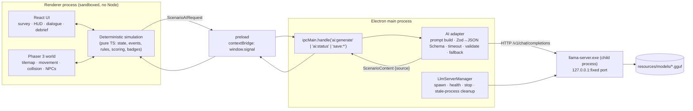

# Signal No. 5: Architecture Lock (DRAFT)

> **Status:** DRAFT, Stage A complete. The stack was approved on 2026-10-09; benchmark-dependent items are marked **PENDING-POC**.
> **Spec role:** this is the approved design spec (Superpowers brainstorming, architectural path). Per `instruction.md` §6 it lives here instead of `docs/superpowers/specs/`.
> **Product scope:** see `project_context.md`. Not duplicated here.
> **Labels:** **[V]** verified source · **[M]** measured · **[E]** estimate · **[P]** proposed · **[U]** unverified.

---

## 1. What is locked

| Decision | Choice | Status |
|---|---|---|
| D1 Demo target | **Windows x64 laptop**, packaged desktop app `SignalNo5.exe`, game and inference on the same machine, offline. Public hackathon pages don't state a mobile requirement. | Approved; **provisional** until the organizers confirm |
| D2 Engine / UI | **Phaser 3.90.0** (final v3) + **TypeScript** + **React** (menus, survey, dialogue, HUD, debrief, badges) | Approved |
| D2b Shell | **Electron 44.x** (44.7.0 latest stable, 2026-10-08 [V]) + **electron-builder**, target **`dir`** (unpacked folder) | Approved |
| D3 Runtime | **llama.cpp `llama-server`**, pinned build **b11517**, **win-cuda-12.4-x64** + the separate CUDA 12.4 runtime zip. The Electron main process starts it as a child process. Vulkan build kept as a fallback. | Approved; PENDING-POC |
| D4 Model | **Qwen3-1.7B Q4_K_M** (thinking off) to prove the pipeline first. **Qwen3-4B-Instruct-2507 Q4_K_M** is the primary candidate, benchmarked only after the PoC passes. **One** model ships in the release. | PENDING-POC |
| D5 Contracts | `project_context.md` §15 **Zod contracts unchanged**, shared by the main and renderer processes. A per-request JSON Schema is generated from Zod for constrained decoding. | Approved |
| D6 Python service | **None.** No Python is needed at runtime. | Approved |
| D7 Downloads | PoC: llama.cpp b11517 CUDA 12.4 (265 MB) + cudart (391 MB) + Qwen3-1.7B (1.1 GB), stored in `D:\signal-llm\`. Qwen3-4B (2.5 GB) waits for a separate proposal. | Approved (PoC part) |

**Evaluated and rejected** (details in `GAME_FRAMEWORK_AND_DEPLOYMENT.md`):
- **Godot 4.7.2.** It scores well, but no one on the team knows it, and the contracts would need re-implementing in GDScript.
- **Tauri.** Rust isn't installed and the team doesn't know it.
- **Python Arcade / pygame-ce.** Weaker for 2D RPG work.
- **PySide6.** Not needed; embedding a game window in it is fragile.
- **Ollama.** A 1.5 GB install and indirect VRAM control.
- **Model-in-engine GDExtensions.** Immature, and they don't isolate crashes.

## 2. Hardware baseline

| | Dev/baseline laptop [M: read-only inspection, 2026-10-09] | Teammate laptop |
|---|---|---|
| OS | Windows 10 Home 22H2 (19045), x64 | [U] |
| CPU / RAM | i5-10300H 4C/8T · 39.9 GB | [U] |
| GPU | GTX 1650 Ti **4 GB** (Turing, CC 7.5), driver 576.02 (CUDA 12.9 class) | RTX 4050 Laptop. Driver [U]; VRAM [U], typically 6 GB |
| Disk free | C: 45.6 GB · D: 516.4 GB | [U] |
| Tools | Python 3.10/3.11, Node 20.20.0, Git 2.53, CUDA toolkit 12.9. No Godot, Ollama or llama.cpp. | [U] |

**Compatibility rule:** the CUDA 12.4 build needs a CUDA-12-class driver. The CUDA 13 build needs driver ≥ 580 [V], so it **won't** run on 576.02. The teammate laptop must report its `nvidia-smi` driver version before it's used as a demo machine. If its driver is incompatible or CUDA fails, fall back to the Vulkan build.

## 3. Architecture



**Boundary rule** (unchanged from `project_context.md` §15): the simulation owns every state transition. The AI returns content and IDs from the allowed lists only, and never changes state.

### 3.1 Renderer security (the renderer cannot run commands)
- `contextIsolation: true`, `sandbox: true`, `nodeIntegration: false`, `webSecurity: true`. Never enable `nodeIntegrationInWorker` or `webviewTag`.
- The preload exposes **only** named functions through `contextBridge.exposeInMainWorld('signal', …)`. It never exposes `ipcRenderer` [V: Electron context-isolation docs]:
  - `ai.generate(req: ScenarioAIRequest): Promise<ScenarioContent>`
  - `ai.narrateDebrief(evaluation: DebriefEvaluation): Promise<DebriefNarration | null>`
  - `ai.status(): Promise<'starting'|'ready'|'unavailable'>`
  - `save.load()` / `save.write(state: GameState)`
- The main process **validates every IPC payload with Zod** before using it. Renderer input is treated as untrusted. No renderer value ever reaches `spawn` arguments or file paths.
- CSP is `default-src 'self'; connect-src 'self'; img-src 'self' data:`. The renderer has **no network access**, which means no CORS and no accidental cloud calls. Navigation and `window.open` are denied, and nothing remote is ever loaded.

### 3.2 LLM server lifecycle (`LlmServerManager`, main process)
1. **Resolve paths.** In a packaged build, `process.resourcesPath/llm/llama-server.exe` and `…/models/<model>.gguf`. In dev, `vendor/llm/` and `D:\signal-llm\models\` via an env var. Paths are **never** taken from the renderer.
2. **Clean up stale processes, with identity checks** (approved refinement). The PID file `userData/llm-server.json` holds `{ pid, exePath, port, startedAt, instanceToken }`. A saved PID alone is **never** enough to kill. Terminate only if **all** of these hold:
   - the PID exists;
   - its `ExecutablePath` (via `Get-CimInstance Win32_Process`) **equals** our resolved `llama-server.exe` path;
   - its command line contains our `--alias signalno5-<instanceToken>` marker (`--alias` confirmed in b11517 and visible in the CIM `CommandLine` [M]); and
   - its creation time matches `startedAt` within a few seconds.

   If any check fails, delete the stale PID file, leave the process alone, and pick another free port.
3. **Check the port.** Bind-test `127.0.0.1:<port>`. If it's taken by something that isn't ours, try the next port in a small fixed range.
4. **Spawn** with `windowsHide: true`, `shell: false`, and fixed arguments only: `-m <gguf> --host 127.0.0.1 --port <p> -ngl 99 -c 3072 -np 1 --no-webui --api-key <random per launch> --alias signalno5-<token>`, plus `--chat-template-kwargs {"enable_thinking":false}` for Qwen3-1.7B. stdout and stderr go to a rotating log in `userData/logs`. Then write the PID file.
5. **Readiness.** Poll `GET /health` (503 while loading, 200 when ready [V]) with a startup timeout (target ≤ 30 s, PENDING-POC). Confirm the log shows all layers offloaded.
6. **Shutdown.** On `before-quit`/`will-quit`, stop the child (`child.kill()` maps to TerminateProcess on Windows), wait for `exit`, and delete the PID file. Also handle `render-process-gone` and an unexpected child `exit`: mark the server `unavailable`, use the fallback, and offer one automatic restart.
7. **No orphans after Electron crashes.** Measured: force-killing Electron also terminates the server, because Node/libuv's kill-on-close job object handles it [M]. Step 2 remains as defence in depth. Never spawn the server with `detached: true`, since that would opt out of the job object.

### 3.3 AI adapter (main process)
- Build the request schema per call from Zod. The `ScenarioAIResponse` schema is specialised so `eventId` is a literal, and `variantId`, `speaker` and `actionIds` items are enums of **that request's** allowed lists. Convert it to JSON Schema and send it as `response_format: {type:"json_schema", json_schema:{schema}}`. llama-server compiles it to a GBNF grammar, enforcing `enum`, `maxLength`, `minItems`/`maxItems`, `required` and `additionalProperties:false` [V]. Zod 4's built-in JSON Schema conversion: PENDING-POC [U].
- **Gaps the server doesn't cover**, so the Zod refinements handle them:
  - **Duplicate `actionIds`:** `uniqueItems` is ignored by the server [V], so Zod rejects repeats.
  - **Words cut by the length cap:** prompt for ≤ 170 / ≤ 140 characters while the schema caps at 200 / 160.
  - **Ungrounded content:** run the §12 blocklist (hotlines, URLs, invented signal levels, medical instructions, "guaranteed/safe to") over the text.
- **Timeout and fallback.** Use a per-request timeout via `AbortController` (target ≈ 8 s, tuned after measurement), retry once, then return the variant's reviewed fallback text. The adapter tags the result `source: 'ai' | 'fallback'`, and the UI labels AI text accordingly.
- **Generation strategy (hybrid, from the approved direction).**
  1. Right after the survey, pre-generate the content for the first phase while the tutorial plays.
  2. After that, generate the next event's variant **at each event transition**, ahead of time.
  3. Cache by `(runId, eventId, variantId)`.
  4. Rendering never waits. If content isn't ready when the event triggers, the reviewed fallback plays.

## 4. Packaging (approved: unpacked directory)

```
SignalNo5/                      ← electron-builder "dir" output (win-unpacked), zipped for hand-off
  SignalNo5.exe
  resources/
    app.asar                    ← renderer + main JS
    llm/                        ← extraResources: the FULL extracted llama.cpp folder
      llama-server.exe, llama*.dll, ggml*.dll (backend DLLs loaded at runtime)
      cudart64_12.dll, cublas64_12.dll, cublasLt64_12.dll   ← from the separate cudart zip
    models/
      <selected>.gguf           ← exactly ONE model in the release
  LICENSES/                     ← Electron/Chromium, llama.cpp MIT, NVIDIA CUDA notice, Qwen Apache-2.0, assets
```

- `llama-server.exe` does **not** contain the CUDA libraries. They come from the separate `cudart-llama-bin-win-cuda-12.4-x64.zip` [V: release assets]. The PoC checks the exact DLL list by launching from the packaged folder on a machine with **no CUDA toolkit on PATH**, to rule out picking up the dev toolkit's DLLs by accident.
- Binaries and models go **outside** `app.asar` via `extraResources`, and code reads them through `process.resourcesPath` [V].
- **Why not the "portable" single exe:** it unpacks into TEMP **on every launch** (`unpackDirName` [V]), which is unworkable with a 1–2.5 GB model.
- **Why not an installer:** an NSIS installer adds work without helping the demo. Deferred.
- Unsigned builds may trigger a SmartScreen warning [E]. Rehearse the demo once from the zipped folder.
- Expected size: ≈ 0.85 GB (runtime + DLLs) + model (1.1 GB, or 2.5 GB for the 4B), so ≈ 2–3.5 GB [E].

## 5. Proof of concept (Stage B, approved, throwaway spike)

| Step | Pass condition |
|---|---|
| 0 | Pinned build, assets and SHA-256 recorded. The CUDA DLL set is identified. |
| 1 | `llama-server` (b11517 CUDA 12.4) serves Qwen3-1.7B from the CLI: `/health` 200, all layers on the GPU, one schema-constrained reply. |
| 2 | Electron (dev) launches → the main process spawns the server → it becomes ready → the renderer calls `window.signal.ai.generate(fixture)` → the response passes Zod → dialogue renders. |
| 3 | An injected invalid response (unknown action ID / bad JSON / over-length) → the fallback renders with `source:'fallback'`. |
| 4 | Quitting the app leaves **no** `llama-server.exe` in `tasklist`. The stale-process cleanup refuses to kill an unrelated process that has a matching PID. |
| 5 | electron-builder `dir` package → steps 2–4 repeated from `SignalNo5.exe` **with networking disabled**. |
| 6 | ≥ 20 representative requests on Qwen3-1.7B: valid-JSON rate, Zod-contract compliance, latency (TTFT if streamed, total), tokens/s, peak RAM/VRAM. Recorded as **[M]**. |
| 7 | **Then** propose the Qwen3-4B benchmark (separate approval). |

Stop and report if the runtime or model proves incompatible. Schema-valid output is **not** proof of educational correctness or narrative coherence; those need human review against reviewed content.

### 5.1 PoC results (2026-10-09) [M]
Spike code is in `spikes/poc-electron-llm/` (throwaway). Full numbers are in `MODEL_AND_RUNTIME_RESEARCH.md` §6.

| Step | Result |
|---|---|
| 0 Build and deps | ✅ b11517 CUDA 12.4 + cudart 12.4, SHA-256 verified. 34 runtime files (llama-server.exe is a small launcher plus `llama-server-impl.dll`, ggml/llama DLLs, `ggml-cuda.dll` 546 MB, `cublasLt64_12.dll` 452 MB, `cublas64_12.dll` 95 MB, `cudart64_12.dll`), 1.14 GB total. |
| 1 CLI server | ✅ Ran with the CUDA toolkit **removed from PATH**. First launch 44.7 s (one-time warm-up), then 3.0 s. |
| 2 Electron dev | ✅ Spawn → ready 2.4 s → `window.signal.ai.generate` → Zod valid → rendered, 3/3. |
| 3 Fallback | ✅ 4/4 injected faults (bad JSON, unknown action, over-length, duplicate) → `source:'fallback'`. |
| 4 Shutdown and cleanup | ✅ Quitting left no `llama-server.exe`. **Force-killing Electron also killed the server.** Node/libuv place children in a kill-on-close job object on Windows, so the crash orphan case is covered by the OS [M]. Identity-verified cleanup: a decoy PID → `left-alone-identity-mismatch` (the decoy survived); a genuine marked stale server → `killed-verified-stale`. |
| 5 Packaged `dir` | ✅ `SignalNo5.exe` (235 MB) + `resources/llm` (1,140 MB) + `resources/models` (1,056 MB), 2.51 GB total, unsigned. It ran 3/3 AI + 4/4 fallback and shut down cleanly. **Offline run: NOT YET DONE** (deferred by the team; needs airplane mode). |
| 6 Benchmark, Qwen3-1.7B | ✅ 30/30 valid. p50 1.94 s / p95 2.15 s. 75 tok/s. +1.55 GB GPU memory. Quality issues are listed in §10. |

**Findings that change the design:**
1. **Toolchain:** Electron 42–44 need **Node ≥ 22.12**. The team standardises on **Node 24 LTS** (24.21.0); this laptop uses a portable copy in `D:\signal-llm\node24`.
2. **`ELECTRON_RUN_AS_NODE=1`** is set by VS Code's extension host and makes `electron.exe` behave as plain Node. Clear it in npm scripts or launch from a normal terminal.
3. **npm 11 blocks install scripts:** Electron's binary download needs `node node_modules/electron/install.js`, or an allow-list entry.
4. **The llama-server API is open to any local page by default** ("CORS allows all origins"). Pass a random per-launch `--api-key`.
5. **Call `powershell.exe` by its absolute System32 path** for identity checks. Never rely on PATH.
6. **First launch is about 45 s:** show a "warming up the AI" state and pre-launch once on the demo machine.

## 6. Parallel work (start now, no engine or runtime dependency)

| Work | Owner (§14) | Depends on |
|---|---|---|
| Shared Zod contracts module (`src/shared/contracts`) + valid/invalid JSON fixtures for two profiles | Backend A + B | Nothing; start first |
| Event catalog (11 events), action effects, variants, reviewed fallback text, as data | Backend A | Contracts |
| 10 badge conditions, debrief findings, checklist text | Backend A | Contracts |
| Philippine safety sources → `SR_*` rules (PAGASA, NDRRMC/OCD, PRC) | Shared | Nothing |
| Licensed 16×16 tilesets/sprites, palettes, house layout in Tiled | Frontend A | Nothing (Phaser loads Tiled JSON) |
| Survey, HUD, dialogue, debrief, badge wireframes, then React components | Frontend B | Contracts for props |
| Prompt templates + fixture-based prompt tests | Backend B | Contracts |

Waiting on the PoC: the packaging config, the final model choice and context size, the timeout values, and the AI-dependent parts of the dialogue UI. **The frontend doesn't wait for the benchmark.** The first integration milestone is the complete playable loop running on fallback content, with AI added on top.

## 7. Proposed repository layout [P]

```
src/
  shared/contracts/      Zod schemas from project_context §15 (+ JSON Schema builders)
  main/                  Electron main: index.ts, ipc.ts, llm/LlmServerManager.ts, ai/adapter.ts, ai/prompts.ts, save.ts
  preload/               index.ts (contextBridge only)
  renderer/
    core/                deterministic simulation (state, events, rules, scoring, badges); no Phaser/React imports
    content/             events, actions, badges, safety rules, fallback text (data)
    game/                Phaser scenes, map, player, NPCs, overlays
    ui/                  React screens and components
tests/                   Vitest (core, contracts, adapter), Playwright for Electron (smoke)
vendor/llm/              (git-ignored) pinned llama.cpp build for dev
spikes/                  (throwaway PoC code, never imported by src/)
```

The scaffolding tool (electron-vite vs Electron Forge + Vite) and the npm package versions are chosen and verified at setup [U].

## 8. Unverified items to close during the PoC
1. That `--alias` is accepted and shows up in the process command line (used for identity checks).
2. Zod 4 JSON Schema export compatibility with llama.cpp's schema subset (no `$ref`; no `properties` + `anyOf`).
3. The exact CUDA DLL set needed at runtime.
4. Real Qwen3-1.7B / 4B latency and VRAM on the GTX 1650 Ti.
5. The RTX 4050 laptop's driver and VRAM.
6. Hackathon device rules (organizers).
7. The current electron-builder version and whether its `dir` target works with Electron 44.

## 10. Proposals arising from the PoC (awaiting approval)

**P1. The engine selects the variant; the AI writes it.** §10 of `project_context.md` already says household profiles decide *which variant plays*. That's a deterministic rule, and the 1.7B model got it wrong 3/3 times. Proposal: the engine sends exactly **one** entry in `allowedVariantIds`, the variant it chose. No field or name changes; only the engine's usage changes.

**P2. The AI may not remove player choices.** The model dropped allowed actions, which silently removes options the deterministic engine decided to offer. Proposal: the per-request schema sets `actionIds` `minItems = maxItems = allowedActionIds.length`, so the AI may **only reorder** them. Zod checks that the set is equal. This tightens the §15 comment "subset of allowedActionIds" to "permutation of allowedActionIds". No field or name changes.

**P3. Qwen3-4B-Instruct-2507 benchmark** (the PoC criteria are met). This is the next decision: see the proposal in the Stage B report.

## 9. Skills used (Stage A)
- **Used:**
  - `superpowers:brainstorming`, architectural path: context, clarifying question, approaches, sectioned design approval.
  - `superpowers:dispatching-parallel-agents`, as the pattern for the two approved research agents.
  - Research Agent B read the installed `huggingface-skills` local-model / `hf-mem` skill guidance. `hf-mem` was not run because it requires a package install.
- **Next:** `superpowers:verification-before-completion` (PoC evidence), then `superpowers:writing-plans` (Stage C).
- **Considered, not used:** frontend/design/animation skills (out of scope), Vercel skills (not applicable), HF training skills (not applicable).

---

## Appendix A: Proposed `project_context.md` edits (NOT applied; awaiting approval)

Only architecture-related sections change. Everything else stays exactly as it is.

**A1. §3, "Critical distinction" paragraph:** append:
> **Selected demo (2026-10-09, provisional pending organizer confirmation):** a packaged Windows desktop app (`SignalNo5.exe`) with game and llama.cpp inference on the same laptop, fully offline. This is laptop-local inference; it must not be presented as on-phone inference.

**A2. §12, "Development runtime" paragraph:** replace it with:
> **Runtime:** llama.cpp `llama-server` (pinned build, Windows CUDA 12.4 + CUDA runtime DLLs; Vulkan build as fallback), started and stopped by the Electron main process and reached only from the main process over `127.0.0.1`. Ollama is not used. Standalone Android inference is deferred beyond the hackathon.

**A3. §12, "Recommended candidate" paragraph:** replace it with:
> **Models:** Qwen3-1.7B Q4_K_M (thinking disabled) is used first to prove the pipeline; Qwen3-4B-Instruct-2507 Q4_K_M is the primary candidate pending benchmark on the GTX 1650 Ti (4 GB VRAM). Exactly one model ships in the release. Apache-2.0 for both.

**A4. §12, "Validate" paragraph:** add:
> Constrained decoding: a per-request JSON Schema generated from the Zod contract is sent to llama-server (`response_format: json_schema`), which enforces shape, enums and max lengths. Because `uniqueItems` is not enforced, Zod additionally rejects duplicate `actionIds`; prompts request text shorter than the schema maximum to avoid truncation.

**A5. §13, the stack table:** replace the rows with:

| Layer | Choice |
|---|---|
| Game | Phaser 3.90.0 + TypeScript |
| App UI | React (Tailwind optional; frontend's choice) |
| Desktop shell | Electron 44.x, packaged with electron-builder (`dir` target → `SignalNo5.exe` folder) |
| Pixel maps | Tiled editor / licensed tilesets (Tiled JSON) |
| Game state | Typed TypeScript simulation module (renderer, no Phaser/React imports) |
| Validation | Zod (shared by the main and renderer processes) + generated JSON Schema for constrained decoding |
| Local persistence | JSON save in Electron `userData` via IPC (replaces IndexedDB) |
| Local inference | llama.cpp `llama-server` child process managed by Electron main |
| Tests | Vitest (core/contracts/adapter) + Playwright Electron smoke tests + manual playtests |
| Repository | Git + GitHub |
| Toolchain | Node.js 24 LTS (Electron 42–44 require Node ≥ 22.12) |

Also replace the **"Alternative: Godot 4…"** paragraph and the **"DECISION NEEDED: final demo target"** block with:
> **Evaluated alternatives:** Godot 4.7.2, Tauri, Python Arcade/pygame-ce and PySide6 were evaluated and not selected (see `docs/architecture/GAME_FRAMEWORK_AND_DEPLOYMENT.md`). **Demo target:** Option A (laptop-local) selected, delivered as a packaged Windows app.

**A6. §15, after the "Rule:" paragraph:** add:
> **Process boundary:** the renderer (sandboxed, no Node) calls only `window.signal.ai.generate(ScenarioAIRequest) → ScenarioContent`, `window.signal.ai.narrateDebrief(DebriefEvaluation) → DebriefNarration | null`, `window.signal.ai.status()`, and `window.signal.save.*`. The Electron main process validates every payload with Zod, owns the llama-server process, and performs all model HTTP calls. Contract names and fields are unchanged.

**A7. §16 table, Hour 0–2 row:** change the acceptance checkpoint to:
> All four can run the app; Electron starts llama-server and returns one Zod-valid `ScenarioAIResponse` offline on the baseline laptop.

**A8. §17, "Reliability" list:** add:
> - Packaged `SignalNo5.exe` launches from the unpacked folder with networking disabled; no Python or separate AI install required.
> - Closing the app leaves no `llama-server.exe` process; stale-process cleanup verifies process identity before terminating anything.
> - If used for the demo, the RTX 4050 laptop passes the same checks.

**A9. §22, Open decisions:** mark them as follows:
> 1. ~~Demo platform~~ **Resolved (provisional):** packaged Windows laptop app. 2. ~~Game engine~~ **Resolved:** Phaser 3.90 + React + Electron. 4. **AI model:** pending PoC/benchmark (1.7B first, then 4B).
