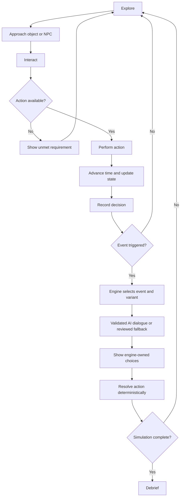
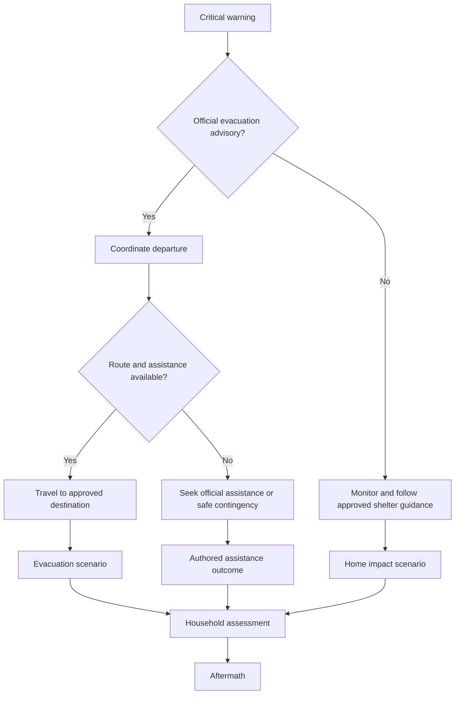
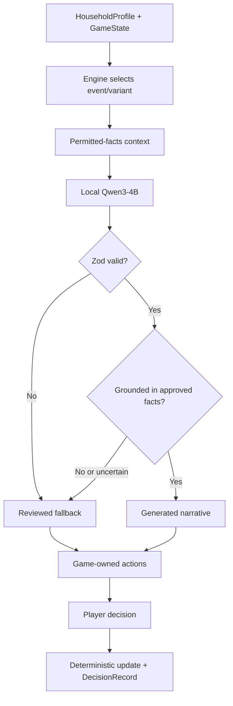
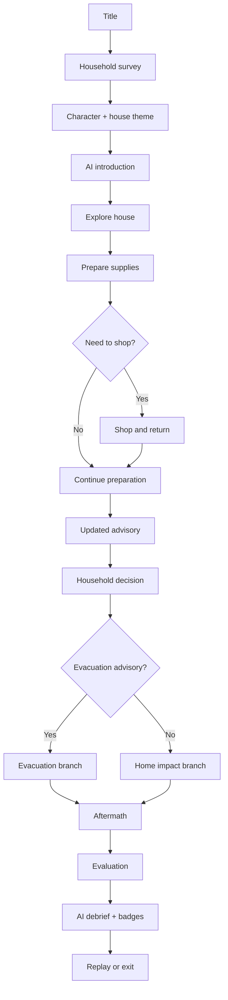

# SIGNAL NO. 5 — Complete Gameplay Mechanics and Simulation Design

**Game Design Specification v3.0 | Interactive 8-bit Typhoon Preparedness RPG**

This specification consolidates the household questionnaire, original game-logic workbook, 17 configuration categories, preparation shop, branching scenarios, and local AI architecture. Numerical settings are provisional game-design parameters, not validated real-world forecasts or medical predictions.

## 1. Locked Design Direction

| Component | Design |
|---|---|
| Game | Top-down explorable 8-bit typhoon preparedness RPG |
| Framework | Phaser 3.90, TypeScript, React, Electron |
| AI | Qwen3-4B Q4 via local llama.cpp server (provisional) |
| Clock | Hybrid: ambient time, action costs, scripted milestones |
| Speed | 1×, 2×, 4×, 8×, 16×, 32× |
| Preparation | 48 simulated hours, subject to storm changes |
| Locations | House, shop, simplified evacuation destination; optional street |
| Visual themes | Modern Filipino / Traditional Filipino |
| Characters | Boy, Girl, Mom, Dad base sprites, outfit variations |
| Consequences | Deterministic simulation; AI only narrates grounded content |
| Output | Packaged offline Windows desktop application |

## 2. Player Journey

| Stage | Player experience | System action | Exit condition |
|---|---|---|---|
| Title | Start/continue/settings | Load save and settings | Start selected |
| Household setup | Survey or fictional household | Validate profile | Profile complete |
| Customization | Select player and house theme | Assign sprites and theme | Confirmed |
| Introduction | Receive fictional typhoon advisory | Initialize storm seed and state | Intro acknowledged |
| Preparation | Explore, inspect, talk, prepare | Update resources, clock, flags | Milestone or landfall |
| Shopping | Visit shop and purchase | Apply travel time, stock, cash | Return home |
| Warning | Receive updates | Re-evaluate available actions | Events resolved |
| Evacuation | Follow relevant official instructions | Route and assistance checks | Branch entered |
| Impact | Experience storm events | Apply authored consequences | Impact ends |
| Aftermath | Review household and supplies | Recovery events | Objectives resolved |
| Debrief | Scores, lessons, badges | Deterministic evaluation + AI narration | Results reviewed |
| Replay | Reuse or change profile | Reset run, new seed | New game |

### Core loop



## 3. Hybrid Time System and 32× Speed

| Variable | Setting | Behavior |
|---|---|---|
| Initial time | Hour 0 | Start of preparation |
| Scheduled landfall | Hour 48 | Fictional schedule |
| Ambient time | 1 game hour / 240 real seconds at 1× | Runs during exploration |
| Action time | Fixed simulated minutes | Added on completed action; never multiplied by speed |
| Landfall acceleration | 0, 4, 8 hours | Authored storm variation |
| Speed options | 1×, 2×, 4×, 8×, 16×, 32× | Accelerate ambient game time |
| Pause | Menus, dialogue, loading, focus loss, mandatory decisions | Stops ambient clock |
| Critical phase | Auto-reset to 1× | Prevents skipped decisions |
| Milestone crossing | Process chronologically | Never skip mandatory events |

| Speed | Real time per simulated hour | Simulated hours per real minute |
|---|---:|---:|
| 1× | 240 s | 0.25 |
| 2× | 120 s | 0.50 |
| 4× | 60 s | 1.00 |
| 8× | 30 s | 2.00 |
| 16× | 15 s | 4.00 |
| 32× | 7.5 s | 8.00 |

**Time scaling:** ambient clock, storm countdown, scheduled NPC routines, event timers, and flood transitions advance with simulation time. Player movement, collisions, UI, dialogue, audio pitch, and actual AI inference remain at normal speed. Weather visuals can be capped for legibility.

```ts
type TimeScale = 1 | 2 | 4 | 8 | 16 | 32;
interface SimulationClock {
  gameMinutes: number;
  timeScale: TimeScale;
  paused: boolean;
  nextMilestoneMinute: number | null;
}
// simulated minutes added by ambient clock:
// (elapsedRealSeconds / 240) * 60 * timeScale
// Fixed-cost actions add their exact simulated-minute cost separately.
```

When a clock update or action crosses a mandatory event, advance to that milestone, pause, resolve it, then continue any remaining time safely.

## 4. Household Initialization

| Survey factor | State initialization | Gameplay effect |
|---|---|---|
| Household count | Exact roster | Supply needs, coordination |
| Six age groups | Age-class counts | Relevant supplies and dialogue |
| Sex/presentation | Sprite assignment | Visual only, no risk multiplier |
| Actual/fictional/randomized | Profile generation mode | Replay variation |
| Assistance needs | Assistance flags | Coordination objectives |
| Pets | Pet props and supplies | Pet preparedness |
| Housing/floors | House context, stairs indicator | Planning choices |
| Surroundings/flood history | Scenario tags | Relevant authored hazard events |
| Roof/exits | Structural and route flags | Safe preparation tasks |
| Medical/accessibility needs | Functional flags | Relevant continuity planning |
| Go-bag/resources | Inventory and readiness | Preparation tasks |
| Plans/warnings/backup power | Information and resource flags | Advisory/outage events |
| Playable character | Player member ID | Dialogue perspective |
| Visual theme | Tile and prop palette | Cosmetic only |

**Roster:** maximum three visible household NPCs besides the player for the MVP; other members remain in a household roster. Boy/Girl/Mom/Dad are visual templates, not guaranteed family relationships. Infants/toddlers use a dependent-character representation. Health details remain optional and locally minimized.

| Fictional budget profile | Cash | Purpose |
|---|---:|---|
| Limited | ₱800 | Tight purchasing choices |
| Moderate | ₱1,500 | Balanced choices |
| Higher | ₱3,000 | More flexibility |

## 5. Explorable World

| Scene ID | Scene | MVP status |
|---|---|---|
| TITLE | Main menu | Required |
| ONBOARDING | Survey | Required |
| CUSTOMIZATION | Character/theme | Required |
| HOUSE | Preparation/exploration | Required |
| SHOP | Community supply shop | Required |
| EVACUATION | Simplified evacuation destination | Required |
| HOME_IMPACT | Storm at home | Required |
| AFTERMATH | Recovery | Required |
| RESULTS | Debrief | Required |
| STREET | Outdoor travel | Optional |
| BARANGAY | Information point | Optional |

| House area | Interactables | Purpose |
|---|---|---|
| Living room | TV, phone, radio, NPC | Warnings and communication |
| Kitchen | Cabinet, sink, food | Food/water preparation |
| Bedroom | Clothes, documents, medication container | Go-bag and supplies |
| Utility area | Tools, flashlight, containers | Equipment |
| Entrance | Door, bag, route indicator | Departure |
| Stairs | Stair interaction | Multi-floor context |
| Windows | Window interaction | Safe pre-storm securing |

| Movement setting | Provisional value |
|---|---|
| Tile grid | 16×16 px |
| Speed | 90 px/s |
| Movement | Four directions, no diagonal MVP |
| Interaction range | 24 px |
| Interact | E / Space |
| Movement | WASD / arrows |
| Collision | Enabled |
| NPC movement | Stationary or short scripts |
| Camera | Fixed or room-following |

## 6. Inventory and Go-Bag

| Variable | Configuration |
|---|---|
| inventory | Item ID to quantity |
| itemLocation | House / Go-bag / Shop / Other |
| inventoryCapacity | No global weight cap in MVP |
| goBagContents | Item IDs and quantities |
| goBagStatus | None / Partial / Ready |
| waterLiters | Survey-derived |
| foodPersonDays | Survey-derived |
| phoneBattery | Workbook default 55% |
| currentCash | Fictional tier |
| medicalSupplyFlags | Applicable needs |
| inventoryLog | Item transactions |

| Action | Prerequisite | Result |
|---|---|---|
| Inspect bag | Bag accessible | Show contents |
| Add item | Item available | Move to bag |
| Remove item | Item packed | Return to storage |
| Check bag | Bag accessible | Evaluate applicable supplies |
| Take bag | Bag accessible | goBagBrought=true |
| Leave bag | Departure | Record supply gap |

Workbook planning baselines: `waterRequirement = 12 × householdSize` liters for three days; `foodRequirement = 3 × householdSize` person-days. Shortfall = `max(0, requirement - available)`. These are game assumptions, not individualized emergency or medical prescriptions.

## 7. Shop and Purchasing

**Flow:** interact at house exit → verify route/shop → apply round-trip travel time → enter small pixel-art shop → approach shopkeeper/shelves → open purchase UI → validate stock and cash → update inventory/cash atomically → return home.

| Variable | Setting |
|---|---|
| shopOpen | True initially |
| shopVisitCount | 0 |
| shopTravelTime | 2 simulated hours round trip |
| shopStock | Item-dependent |
| shopClosureHour | Scenario-defined |
| shopPriceMultiplier | 1.0 |
| latePriceMultiplier | 1.5, optional original workbook rule |
| totalSpent | 0 |
| purchaseHistory | Empty |
| shopkeeperId | Fixed NPC |

| Item | Fictional price | Effect |
|---|---:|---|
| Water jug | ₱100 | +20 L |
| Food pack | ₱280 | +6 person-days |
| Prescribed medication refill | ₱350 | Approved medication-supply flag |
| Flashlight | ₱120 | +1 |
| Power bank | ₱450 | +1 |
| First-aid kit | ₱200 | +1 |
| Tools | ₱250 | +1 |
| Battery-powered radio | ₱250 | +1 |
| Fuel | ₱150 | +1 unit |
| Batteries / hygiene / pet / child-care supplies | TBD | +1 relevant pack |

| Restriction | Behavior |
|---|---|
| Closed shop or road | Travel unavailable |
| Official urgent evacuation instruction | Nonessential shopping unavailable |
| Insufficient cash or stock | Reject purchase without state change |
| Purchase success | Cash and inventory update together |
| Mandatory milestone crossed | Pause shopping for event |
| Already prepared household | Shopping optional |

## 8. Preparation Action Registry

| Action ID | Action | Time cost | Prerequisites | Effect |
|---|---|---:|---|---|
| GET_TOOLS | Retrieve tools | 0.25 h | Accessible | Tools acquired |
| BOARD_WINDOW | Prepare window | 1.5 h | Tools, safe conditions | Count +1 |
| SECURE_ROOF | Arrange safe roof preparation | 3 h | Tools, safe pre-storm conditions | Roof flag |
| SECURE_OBJECTS | Secure loose items | 0.5 h | Safe conditions | Loose-item flag |
| FILL_CONTAINERS | Fill containers | 0.5 h | Tap | +15 L, max twice |
| FILL_DRUM | Fill drum | 1 h | Drum, tap | +60 L |
| PACK_GO_BAG | Pack bag | 1.5 h | Bag and supplies | Bag readiness |
| CHARGE_PHONE | Charge phone | 2 h | Power | Battery increased |
| PROTECT_DOCUMENTS | Waterproof documents | 0.5 h | Documents | Protection flag |
| RAISE_BELONGINGS | Move belongings | 2 h | Suitable storage | Relocation |
| FAMILY_MEETING | Discuss plan | 0.5 h | NPC available | Coordination flag |
| CHECK_BULLETIN | Check official information | 0.5 h | Phone/radio | Advisory knowledge |
| SANDBAG_GATE | Prepare gate | 1.5 h | Gear, safe conditions | Gate flag |
| SHOP_TRIP | Shop | 2 h | Shop/route open | Shopping |
| BARANGAY_VISIT | Visit barangay | 1.5 h | Route open | Information/assistance |
| PACK_MEDICATION | Prepare essential supplies | 0.5 h | Relevant supplies | Medical readiness |
| PREPARE_PET_SUPPLIES | Organize pet supplies | 0.5 h | Pets | Pet readiness |
| ARRANGE_ASSISTANCE | Coordinate help | 1 h | Assistance need | Plan updated |
| PREPARE_COMMUNICATION | Set contact plan | 0.5 h | None | Communication flag |

No dangerous outdoor preparation or travel after the scenario declares unsafe conditions.

## 9. Storm Progression

| Time | Event | Gameplay |
|---|---|---|
| Hour 0 | Initial fictional official advisory | Begin preparation |
| Hour 8 | Readiness reminder | Inspect gaps |
| Hour 16 | Supply checkpoint | Shop/coordinate |
| Hour 24 | Updated advisory, possible acceleration | Reassess |
| Hour 32 | Household dilemma | Relevant needs |
| Hour 36–44 | Possible official evacuation advisory | Respond appropriately |
| Hour 40–48 | Possible closure/outage | Limited preparation |
| Landfall | Impact | Shelter/evacuation events |
| Landfall +3 | Scenario hazard peak | Impact decisions |
| Landfall +6 | Changing conditions | Household check |
| Recovery Days 1–3 | Aftermath | Assess, plan, reflect |

| Storm variable | Values |
|---|---|
| stormSeed | Integer |
| landfallAcceleration | 0 / 4 / 8 h |
| windFactor | 0.85–1.30 (fictional internal parameter) |
| floodVariation | −0.2 to +0.3 m (original experimental parameter) |
| powerOutageEvent | Enabled/disabled |
| roadClosureEvent | Enabled/disabled |
| shopClosureEvent | Enabled/disabled |
| evacuationAdvisoryEvent | Authored scenario |
| misinformationEvent | Enabled/disabled |

Mandatory events are processed chronologically, never skipped at 32×. Rumors do not determine physical hazards.

## 10. Event Catalog

| ID | Event | Trigger | Game-owned choices / consequence focus |
|---|---|---|---|
| EV01 | Initial advisory | Hour 0 | Check advisory, review plan |
| EV02 | Go-bag inspection | Bag interaction | Inspect, organize, defer |
| EV03 | Household coordination | NPC interaction | Discuss, assign, defer |
| EV04 | Supply gap | Inventory gap | Check storage, shop, prioritize |
| EV05 | Medical preparedness | Relevant functional need | Review supplies, arrange continuity, defer |
| EV06 | Updated warning | Hour 24 / milestone | Read, reassess |
| EV07 | Rumor | Authored misinformation event | Verify, ignore, forward unverified |
| EV08 | Evacuation advisory | Approved advisory issued | Review, prepare, follow instructions |
| EV09 | Power interruption | Outage event | Use lighting, safe alternatives, check needs |
| EV10 | Shelter hazard | Authored hazard | Safe response, account for members, seek help |
| EV11 | Evacuation arrival | Arrival | Account, check supplies, review updates |
| EV12 | Household dilemma | Profile-specific | Approved contextual choices |
| EV13 | Household status | Impact ends | Account, review needs |
| EV14 | Resource review | Recovery starts | Water, food, medical supplies |
| EV15 | Recovery update | Approved update | Verify guidance, plan |
| EV16 | Final reflection | Recovery complete | Review and finish |

| Event | Household state | Selected variant |
|---|---|---|
| EV04 | Limited cash, incomplete bag | SUPPLY_BUDGET_GAP |
| EV04 | Infant, missing child supplies | CHILD_SUPPLIES_GAP |
| EV04 | Medication supplies incomplete | MEDICATION_SUPPLY_GAP |
| EV04 | Bag complete | SUPPLIES_READY |
| EV09 | Flashlight/power bank | BACKUP_READY |
| EV09 | No backup lighting | LIGHTING_GAP |
| EV08 | Assistance arranged | ASSISTANCE_READY |
| EV08 | Assistance unplanned | ASSISTANCE_UNPLANNED |

Engine selects event/variant and controls actions; AI narrates within permitted facts.

## 11. Evacuation Branching



| Variable | Values |
|---|---|
| evacuationAdvisoryIssued | Boolean |
| evacuationDecision | Pending / Comply / Delay / Decline / Seek assistance |
| destinationKnown | Boolean |
| routeStatus | Open / Restricted / Closed / Unknown |
| transportAvailable | Boolean |
| assistanceRequired / assistanceArranged | Boolean |
| membersAccountedFor | Boolean |
| goBagBrought | Boolean |
| evacuationCompleted | Boolean |
| currentShelter | Home / Evacuation center / Approved destination |

| Situation | Action | Effect |
|---|---|---|
| Advisory, route open | Comply | Departure |
| Assistance required | Arrange | Coordination flag |
| Destination unknown | Seek verified info | Knowledge flag |
| Advisory delayed | Delay | Time passes; route may change |
| Route closed | Attempt route | Block unsafe action, offer contingency |
| No advisory | Monitor | Continue relevant phase |
| Shelter arrival | Account for members | Status update |
| Arrival without supplies | Inspect needs | Preparedness gap |

## 12. Impact and Hazard States

| Variable | Values / effect |
|---|---|
| weatherState | Clear / Rain / Heavy rain / Typhoon |
| windSeverity | Low / Moderate / Severe |
| floodSeverity | None / Low / Moderate / Severe |
| powerAvailable | Boolean |
| tapWaterAvailable | Boolean |
| roadStatus | Open / Restricted / Closed |
| shelterCondition | Normal / Compromised / Unsafe |
| windowDamage / roofDamage | None / Minor / Major |
| documentsProtected | Boolean |
| suppliesStoredSafely | Boolean |
| householdSafetyStatus | Normal / Assistance needed / Critical event |

| Flood severity | Visual | Mechanics |
|---|---|---|
| None | No water | Normal interactions |
| Low | Limited exterior overlay | Awareness event |
| Moderate | Expanded overlay | Exterior restrictions |
| Severe | Major water overlay | Unsafe routes blocked |

| Preparation | Possible authored consequence |
|---|---|
| Documents protected | Less document exposure in applicable event |
| Supplies stored safely | Supplies may remain available |
| Loose objects unsecured | Loose-object event eligible |
| Roof preparation incomplete | Shelter event eligible |
| Belongings raised | Property outcomes differ |
| Power bank charged | Backup communication available |
| No backup lighting | Lighting interactions restricted |

The workbook's numeric flood-height and health-damage formulas are experimental and **not activated in the MVP**. No preparedness action guarantees immunity from damage.

## 13. Aftermath and Recovery

| Day | Focus | Interactions | Exit |
|---|---|---|---|
| 1 | Household assessment | Account for members, updates, supplies | Assessment done |
| 2 | Essential needs | Food, water, medication, communication | Applicable tasks done |
| 3 | Recovery reflection | Review decisions and priorities | Debrief unlocked |

| Variable | Initial value |
|---|---|
| aftermathDay | 1 |
| remainingWater / remainingFood | Inventory-derived |
| medicalContinuityStatus | Profile-derived |
| householdAccountedFor | State-derived |
| officialUpdatesChecked | False |
| recoveryObjectives | Event-derived |
| recoveryTasksCompleted | Empty array |
| aftermathComplete | False |

| Condition | Educational finding |
|---|---|
| Insufficient water | Water planning gap |
| Insufficient food | Food planning gap |
| Medication continuity unplanned | Medical planning gap |
| Incomplete communication | Coordination gap |
| Unverified rumor shared | Information literacy gap |
| Relevant supplies prepared | Competency demonstrated |
| Appropriate advisory followed | Evacuation-response competency |

## 14. Scoring and Endings

| Competency | Weight |
|---|---:|
| Emergency supplies | 20 |
| Official information | 20 |
| Household coordination | 15 |
| Evacuation preparedness | 20 |
| Household-specific needs | 15 |
| Hazard awareness | 10 |
| **Total** | **100** |

`score = 100 × earnedApplicableObjectivePoints / maxApplicableObjectivePoints`.

Non-applicable objectives are excluded/reweighted. Undisclosed health information is not penalized. Score measures decisions, not demographic characteristics or storm severity.

| Ending | Proposed trigger |
|---|---|
| Handa | 85–100 |
| Nakaraos | 60–84 |
| Nahirapan | 0–59 |
| Na-rescue | Separate authored assistance outcome, not a health threshold |

## 15. Badges and Debrief

| ID | Badge | Unlock condition |
|---|---|---|
| B01 | Handa ang Bag! | Applicable go-bag objectives |
| B02 | Tubig at Pagkain | Food/water objectives |
| B03 | Balitang Beripikado | Verify unconfirmed information |
| B04 | Pamilyang Handa | Coordination objectives |
| B05 | Ligtas na Dokumento | Protect documents |
| B06 | May Plano Tayo | Establish communication plan |
| B07 | Walang Maiiwan | Account for all members |
| B08 | Handa sa Dilim | Prepare/use backup lighting |
| B09 | Tamang Desisyon | Respond appropriately to advisory |
| B10 | Signal No. 5 Master | All applicable core competencies |

| Debrief element | Source |
|---|---|
| Score and strengths | Deterministic evaluator |
| Narrative outcome | Authored scenario |
| Decision timeline | Decision log |
| Preparedness gaps | Reviewed rules |
| Action plan and lesson cards | Reviewed guidance |
| Narrative wording | Local AI grounded in evaluation |
| Badges | Achievement engine |
| Replay | Game controller |

## 16. Local AI Director

| Content | Owner |
|---|---|
| Event and variant | Game engine |
| Warnings, advisories, destinations | Approved scenario data |
| Actions and order | Game engine |
| Inventory and NPC identities | Game state |
| NPC dialogue and descriptions | Local AI |
| Consequences, score, badges | Deterministic engine |
| Educational facts | Reviewed knowledge base |
| Debrief wording | Local AI using verified findings |

Each request supplies event ID/variant, storm phase, relevant household and NPC context, exact available/unavailable inventory, approved facts, recent decisions, immutable allowed actions, and the existing `ScenarioAIResponse` schema. Sensitive medical details are minimized.

| Generation trigger | Behavior |
|---|---|
| Setup complete | Generate introduction |
| Event eligible | Pre-generate and cache |
| NPC interaction | Display cached text |
| Decision completed | Generate continuation in background |
| New phase | Generate narration |
| Debrief | Narrate verified evaluation |
| Failure | Reviewed fallback |



| Setting | Provisional value |
|---|---|
| Model | Qwen3-4B-Instruct-2507 Q4_K_M |
| Runtime | llama.cpp CUDA 12.4 |
| Context | 2,048 tokens |
| Output cap | 220 tokens |
| Concurrency | 1 |
| Normal timeout | 12 s, to be tested |
| Warm-up | Loading screen |
| Fallback | Reviewed static text |
| AI state mutation | Forbidden |

## 17. Architecture, Persistence, Tests and Roadmap

| Module | Technology | Responsibility |
|---|---|---|
| Desktop | Electron | Window, process lifecycle, packaging |
| Game | Phaser 3 | Tilemap, movement, collision |
| UI | React | Survey, shop, inventory, dialogue, results |
| Simulation | TypeScript | State and consequences |
| Contracts | Zod | Schema validation |
| Scheduler | TypeScript | Events and time |
| Household initializer | TypeScript | Survey mapping |
| Shop engine | TypeScript | Stock and cash |
| Achievements/evaluator | TypeScript | Badges and scores |
| AI adapter | Electron main | Local inference requests |
| Inference | llama.cpp | Qwen model |
| Saves | Local JSON files | Progress |
| Tests | Vitest + Playwright | Logic and UI |

| Saved data | Replay behavior |
|---|---|
| Household profile, character, theme | Optionally retained |
| Inventory, clock, events, decisions | Reset |
| Storm seed | Reset or explicitly reuse |
| Score | New per run |
| Earned badges | Persist |
| Generated dialogue cache | Clear |
| Sensitive health information | User-controlled local retention and deletion |

| Implementation stage | Acceptance |
|---|---|
| 1. Foundation | Electron/React/Phaser launch |
| 2. World | Movement, collision, interaction |
| 3. Clock | Hybrid speed 1×–32×, no missed milestones |
| 4. Household | Survey initializes state |
| 5. Inventory | Collect and pack items |
| 6. Shop | Buy, deduct cash, return |
| 7. Scheduler | Storm events trigger |
| 8. Branching | Decisions persist |
| 9. AI | Grounded dialogue or fallback |
| 10. Evacuation | Advisory response works |
| 11. Impact | Hazard states render |
| 12. Aftermath | Recovery objectives |
| 13. Debrief | Score, lessons, badges |
| 14. Package | Full `.exe` runs |
| 15. Validate | Offline end-to-end playthrough |

### Minimum complete playthrough



### Acceptance test matrix

| Test | Expected result |
|---|---|
| Four-member household | Four roster entries |
| Two-story home | Context updated; fixed geometry retained |
| Traditional theme | Correct assets applied |
| Player against wall | Collision stops movement |
| Approach bag | Interaction prompt |
| Collect water | Inventory increases |
| Buy flashlight | Cash decreases, item increases |
| Insufficient funds | No state change |
| 32× speed | Ambient clock scales correctly |
| Cross mandatory milestone at 32× | Event triggers once and pauses |
| Dialogue at 32× | Clock paused; text readable |
| 1.5-hour action at 32× | Exactly 1.5 game hours charged |
| Relevant medical need | Appropriate reviewed event eligible |
| Outage with/without light | Distinct available interactions |
| Official advisory | Game-owned actions displayed |
| Unsupported AI fact | Reject when detected, fallback |
| Model unavailable | Playthrough continues |
| Aftermath complete | Deterministic debrief |
| Badge earned | Deterministic unlock |
| Replay | Run state resets |
| Packaged `.exe` offline | Game and model function without internet |

## Open Tuning Parameters

| Parameter | Provisional value | Validation |
|---|---|---|
| Ambient rate | 240 real seconds/game hour at 1× | Playtest pacing |
| Speed maximum | 32× | Event processing and UX |
| Preparation duration | 48 game hours | Enough time for actions |
| Shop travel | 2 game hours round trip | Opportunity cost |
| Movement | 90 px/s | Sprite/map scale |
| Interaction radius | 24 px | Usability |
| Event catalog | 16 | Branch coverage |
| Score | Six categories, 100 points | Fairness |
| Endings | 85 / 60 thresholds | Educational interpretation |
| Model | Qwen3-4B | Full-game grounding and VRAM |

**Implementation priority:** build the hybrid clock and event scheduler alongside player movement. Shopping, warnings, branching, and 32× fast-forward all depend on one reliable source of simulation time.
